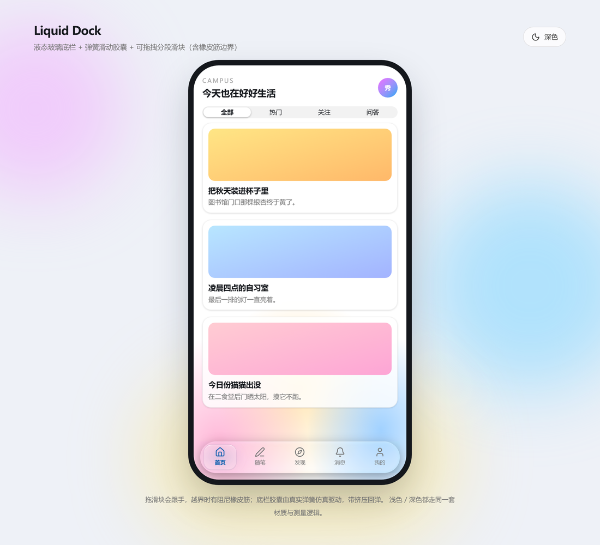
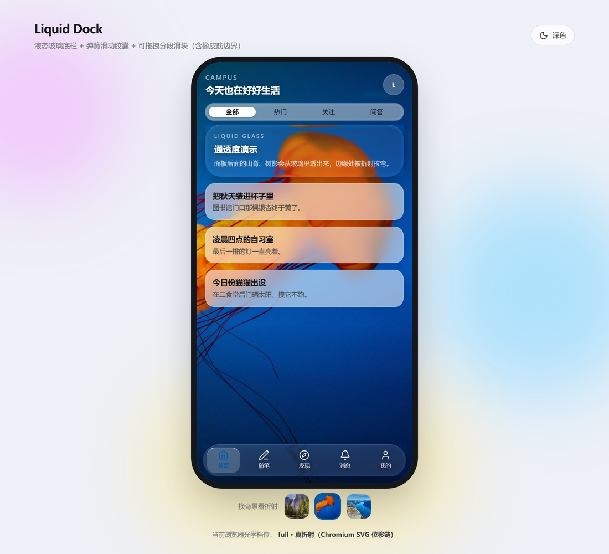
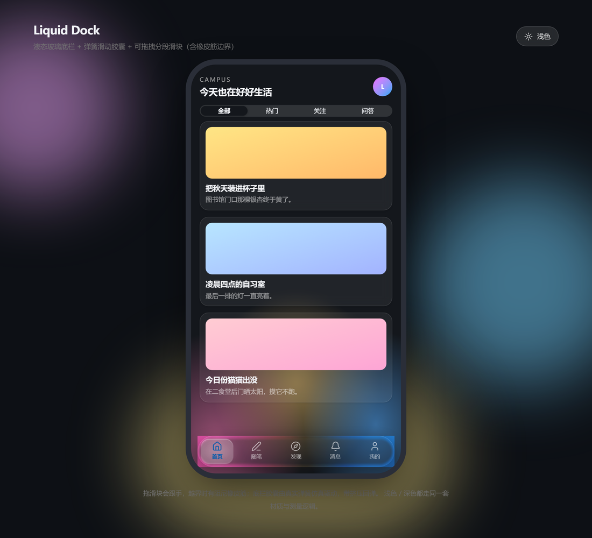

# Liquid Glass Dock

**液态玻璃底栏 + 玻璃面板**（本包不含滑块）。从一款线上校园社区应用里抽出来的材质实现，MIT 开源。



| 浅色 · 山林 | 浅色 · 深海 | 深色 · 山林 |
| --- | --- | --- |
|  |  |  |

## 里面有什么

| 组件 | 说明 |
| --- | --- |
| `DockGlassSurface` | 底栏玻璃材质：边缘透镜折射 + 模糊 + 主题染色，浅/深两套光学参数 |
| `GlassPanel` | 同一材质的大块玻璃面板（卡片/浮层用），圆角 28、环宽 5、tint 0.12 |
| `RefractionImage` | **全兼容折射**：不依赖 `backdrop-filter`，用 SVG 位移滤镜弯曲一张背景图，Safari / Firefox / 微信也能出折射 |
| `LiquidSurface` | 底层实现：测量、位移贴图生成、滤镜挂载、暗色增量 |

> 需要「选中态滑块胶囊」的导航是另一个组件（弹簧滑块），本包有意不包含。

## 快速开始

```bash
npm install
npm run dev      # http://localhost:5173
npm run build    # 产物在 dist/
```

演示页用 Tailwind v4（`@tailwindcss/vite`）。组件里的工具类需要你的项目也有 Tailwind，或把类名换成自己的 CSS。

> **在线演示**：仓库自带 GitHub Pages 工作流，首次需在 `Settings → Pages → Source` 选 **GitHub Actions**，再手动跑一次 `Deploy demo to Pages`。
>
> 演示页是 **playground**：一整屏可滚动长图（折射校准图 + 6 张照片）+ 一块液态玻璃。
> 右上角「调参」可切换 **圆角卡片 / 胶囊底栏 / 圆形 / 方块**，并实时调整光学厚度、折射环宽、圆角、尺寸、
> 折射率、模糊、奶白、饱和度、高光、光照角度；调好可直接 **复制 TSX 代码** 或 **复制带参数的分享链接**。
> 另有 **「线上原版（实时）」** 引擎：`DockGlassSurface` 默认 `local-tuned` 材质的真实参数与代码，
> 用来和全兼容版对照（它只在 Chromium 出真折射）。
> 拼接原图放在 `artwork/`（不进产物），要换背景重新拼一张 `public/bg/scroll.jpg` 即可。

## 用法

### 底栏玻璃

```tsx
import DockGlassSurface from './components/liquid/DockGlassSurface'

<DockGlassSurface>
  <div className="relative grid grid-cols-5">{/* 5 个 tab */}</div>
</DockGlassSurface>
```

| 参数 | 类型 | 默认 | 说明 |
| --- | --- | --- | --- |
| `variant` | `'current' \| 'local' \| 'local-tuned' \| 'fine'` | `local-tuned` | 四套光学剖面，线上在用的是 `local-tuned` |
| `enableLens` | `'auto' \| boolean` | `'auto'` | `true` 强制挂折射链、`false` 只走兼容磨砂 |

### 玻璃面板

```tsx
import GlassPanel from './components/liquid/GlassPanel'

<GlassPanel className="px-4 py-3.5" radius={26}>
  <p className="text-white">通透度演示</p>
</GlassPanel>
```

### 全兼容图片折射

```tsx
import { useRef } from 'react'
import RefractionImage from './components/liquid/RefractionImage'

const photoRef = useRef<HTMLImageElement>(null)


<RefractionImage
  src="/photo.jpg"
  backdropRef={photoRef}
  radius={26}
  bevel={20}
  strength={22}
  className="w-full"
>
  <div className="px-4 py-3">内容</div>
</RefractionImage>
```

| 参数 | 类型 | 默认 | 说明 |
| --- | --- | --- | --- |
| `src` | `string` | 必填 | 背景图，玻璃折射的就是它 |
| `backdropRef` | `RefObject` | 建议必填 | 页面里那张真实背景图；靠它把玻璃里的画面与背景**逐像素对齐**，滚动时也会重算 |
| `radius` | `number` | `28` | 圆角 |
| `bevel` | `number` | 短边/4 | 折射环宽度（上限短边的一半） |
| `strength` | `number` | `34` | 玻璃光学厚度：12 细腻 / 22 标准 / 44 夸张 |
| `ior` | `number` | `1.5` | 折射率 |
| `blur` | `number` | `0.5` | 位移前高斯模糊：0.5 高透，**8 左右就是磨砂玻璃**，边缘折射仍保留 |
| `veil` | `number` | `0.08` | 一层薄奶白（0~1），解决"太透/文字读不清"，0 关闭 |
| `saturation` | `number` | `1` | 饱和度，`1.15` 与 `GlassPanel` 一致（磨砂后不发灰） |
| `specular` | `number` | `1` | 边缘高光强度 |
| `lightAngle` | `number` | `-55` | 高光方位角（度），对称两侧各一弯亮弧 |
| `style` | `CSSProperties` | — | 固定尺寸测试（圆形/方块）时传 `width`/`height` |

> 想和对面的实时版一样通透：`blur={3} saturation={1.15} veil={0.05} bevel={12}`。演示页底栏用的是 `blur={3} saturation={1.15} veil={0.06} bevel={16} strength={22}`。

原理（与 Apple Liquid Glass 的 Web 复现同一套物理，代码为本项目自己实现）：

1. 圆角矩形 SDF → 每像素离边距离与法线；
2. 边缘是凸面 squircle 剖面 `h(t)=(1-(1-t)^4)^(1/4)`，求表面倾角 θ1；
3. 斯涅尔定律 `sinθ1 / ior = sinθ2`，位移 `= tan(θ1-θ2) × strength`，**朝面板中心**——凸面聚光，所以边缘是放大弯折，不是涂抹拉伸；
4. 高光用三维法线与水平光的 `|N·L|`，在对称两侧形成两弯亮弧；
5. 位移图/高光图按 **3 倍超采样**在 canvas 生成，交给 `feImage → feDisplacementMap` 执行。

`feDisplacementMap` 在 Safari / Firefox / 微信 X5 都支持——**不兼容的只是 `backdrop-filter` 收不收 `url()`**。

参考（物理模型与写法启发，非代码来源）：
[kube.io：Liquid Glass in the browser](https://kube.io/blog/liquid-glass-css-svg/)、
[xanaxknight/liquid-glass-css-svg](https://github.com/xanaxknight/liquid-glass-css-svg)、
[VII-Cae/hyalite--liquid-glass](https://github.com/VII-Cae/hyalite--liquid-glass)。

> 注意：它折的是"一张背景图"，不是任意 DOM。要折实时页面内容，只能用 Chromium 的 `GlassPanel`。

## 为什么在别人项目里像"一层薄玻璃"

实时折射（折的是页面真实合成内容）**只有 Chromium 内核成立**。组件在根节点标注了状态，排查先看：

```js
const el = document.querySelector('[data-liquid-surface]')
el.dataset.lens            // 'on' = 真折射；'off' = 兼容磨砂
el.dataset.lensCapability  // 'full' | 'static' | 'none'
```

| 环境 | 档位 | 表现 |
| --- | --- | --- |
| 桌面 / 安卓 Chrome、Edge | `full` | 实时真折射 |
| 安卓厂商浏览器、微信 Android | `static` 或 `none` | 支持时折射；`url(#svg)` 被内核丢掉时落兜底 |
| iPhone / iPad 上的一切浏览器 | `none` | WebKit 不支持 → 兼容磨砂（要折射请用 `RefractionImage`） |
| 桌面 Safari、Firefox | `none` | 同上 |

兜底档是加厚磨砂：`blur(16~18px) saturate(160~180%)` + 内阴影 + 镜面高光，不会退化成薄雾。

除内核外还有四个常见坑：背景是纯色（没东西可折）、祖先带 `filter`/`transform`/`backdrop-filter`（换了采样画布）、全局 CSS 覆盖了 `backdrop-filter`、父容器 `overflow:hidden` 裁掉外扩采样区。

## 实现要点

- **测量**：`useLayoutEffect` 在 paint 前量尺寸，首帧即正确；`ResizeObserver` 负责尺寸变化后重测。
- **位移贴图**：`buildLiquidLens.ts` 为圆角矩形边缘生成位移图；采样环用 CSS `gradient mask` 剪出（`image-mask` / `feComposite` 在 Chromium 上会被裁掉）。
- **暗色增量**：`darkProfile` 单独覆盖，避免浅色折射把深色底冲淡。
- **安全区**：组件不写死内边距，由使用方按 `--sat` / `--sab` 处理。

## 浏览器

Chromium（桌面与安卓）走实时折射；Safari / Firefox / 微信落兼容磨砂；需要全平台折射时用 `RefractionImage` + 图片/视频背景。

## 灵感与致谢

代码为本仓库原创（从线上产品抽出），技术思路并非凭空：

- **液态玻璃的位移贴图路线**：来自 Apple 2025 WWDC 的 Liquid Glass 设计语言的公开原理；本仓库为自研实现。
- **演示背景照片**：来自 [Unsplash](https://unsplash.com)（经 [picsum.photos](https://picsum.photos) 分发），仅用于展示折射效果，不随 MIT 授权。
- **第三方依赖**：React / React DOM（MIT）、Vite（MIT）、Tailwind CSS（MIT）、TypeScript（Apache-2.0）、lucide-react 图标（ISC）。

## License

MIT © 2026 Liquid Glass Dock contributors

---

## English

A liquid-glass **bottom dock** and **glass panels**, extracted from a production campus app.

- `DockGlassSurface` — edge-lens refraction + blur + theme tint (light/dark profiles).
- `GlassPanel` — same material as a large card (radius 28, rim 5, tint 0.12).
- `RefractionImage` — real edge refraction **without** `backdrop-filter: url()`: an SVG displacement filter bends the backdrop image, so it also works in Safari, Firefox and WeChat.

Live refraction of arbitrary scrolling DOM is Chromium-only; elsewhere the component degrades to a thick frosted material. No slider/segmented control is included. MIT licensed.
